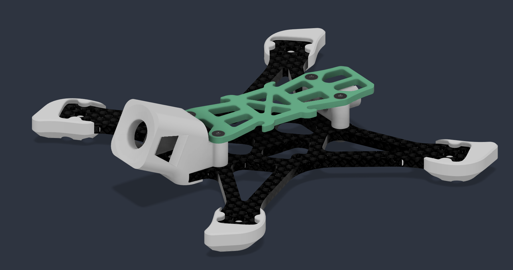
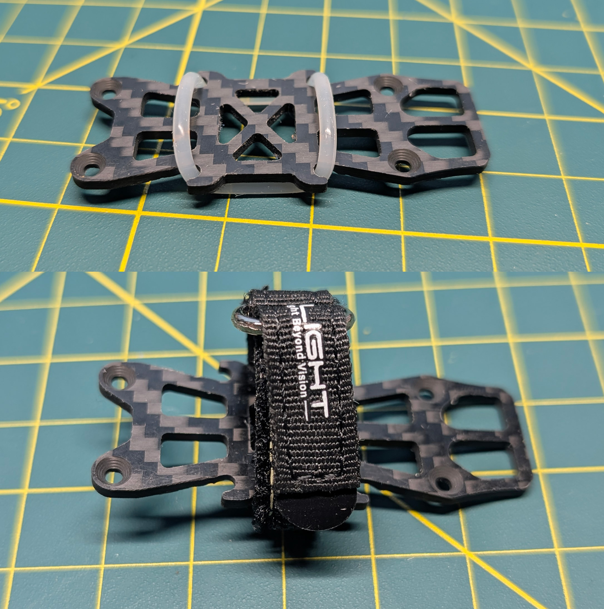
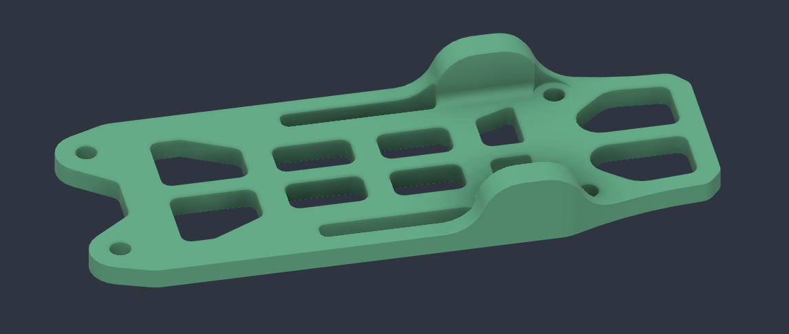
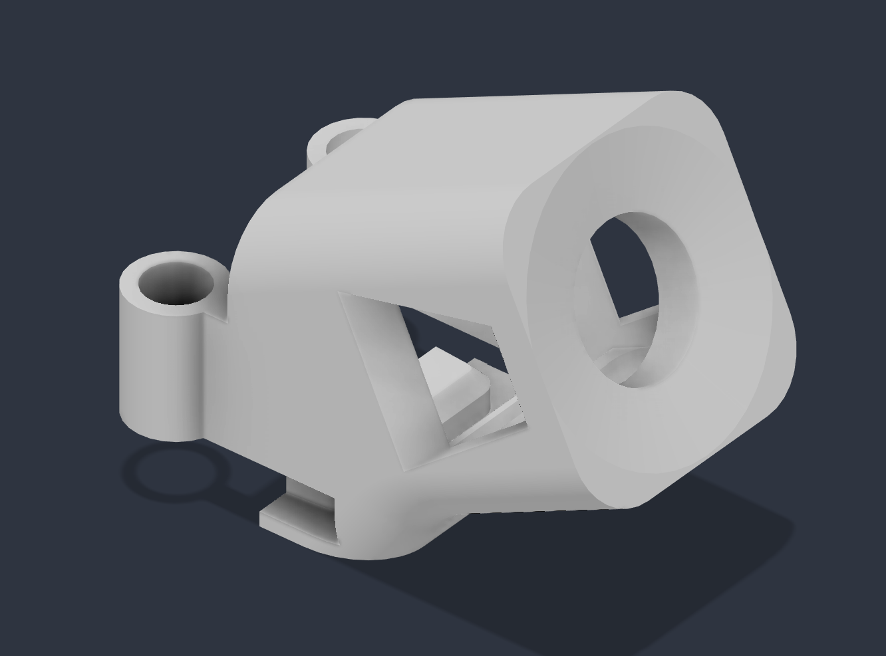
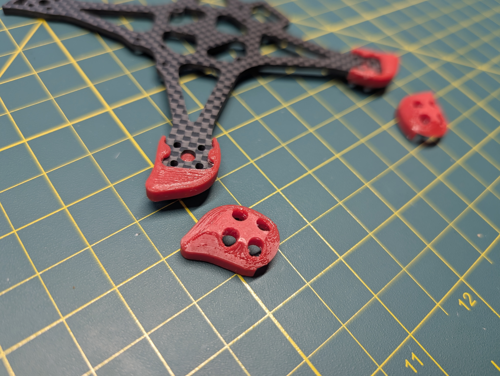
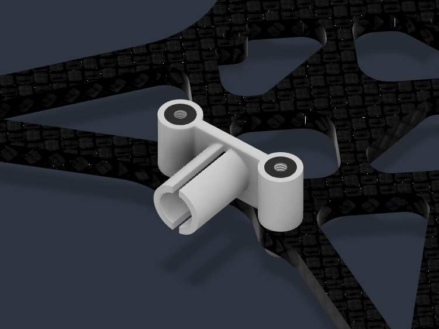

# Top Plate

The Top plate can be cut from carbon or 3D printed. The primary version is the hook and O-Ring design by Auburn which allows for simple battery swaps, while also allowing for a traditional battery strap.

Given the complexity and cost of machining carbon fiber paltes, the top plate can also be printed. This allows for easy replacements while also creating opportunities to add features such as these bumpers to keep the battery centered. To improve rigidity, printing in PET, PC, ASA or any other tough filament would be recommended

The original strap only design may be found in the outdated directory if desired.

# Camera mount

Designed with compatibility in mind with camera mounts from [Kayoumini](https://www.printables.com/model/833046-kayoumini-25-tpu-collection) This mount for HDZero Lux at 25 degrees includes an added bottom lip to help keep it centered. Print in TPU to dampen vibrations and soften impacts. Given the overhangs, printing these canopies with supports will be needed. Printable support structures can be made to further help with the printing of these canopies using PLA support material or pre-print a base that can be attached/detached:  [Canopy print support](https://www.printables.com/model/1330393-kayoumini-camera-tpu-print-support)

Locking lip helps prevent the canopy from shifting left to right and avoid prop-strikes.

# Bumpers

TPU printable feet can help reduce impact damage on the edge of the limbs and further protect the motors. 

# Antenna

For weight savings, the slim antenna mount can be printed

If you are having trouble with noise during punchouts with the HDZero AIO, a circular polarized antenna with an extended antenna mount may help.
